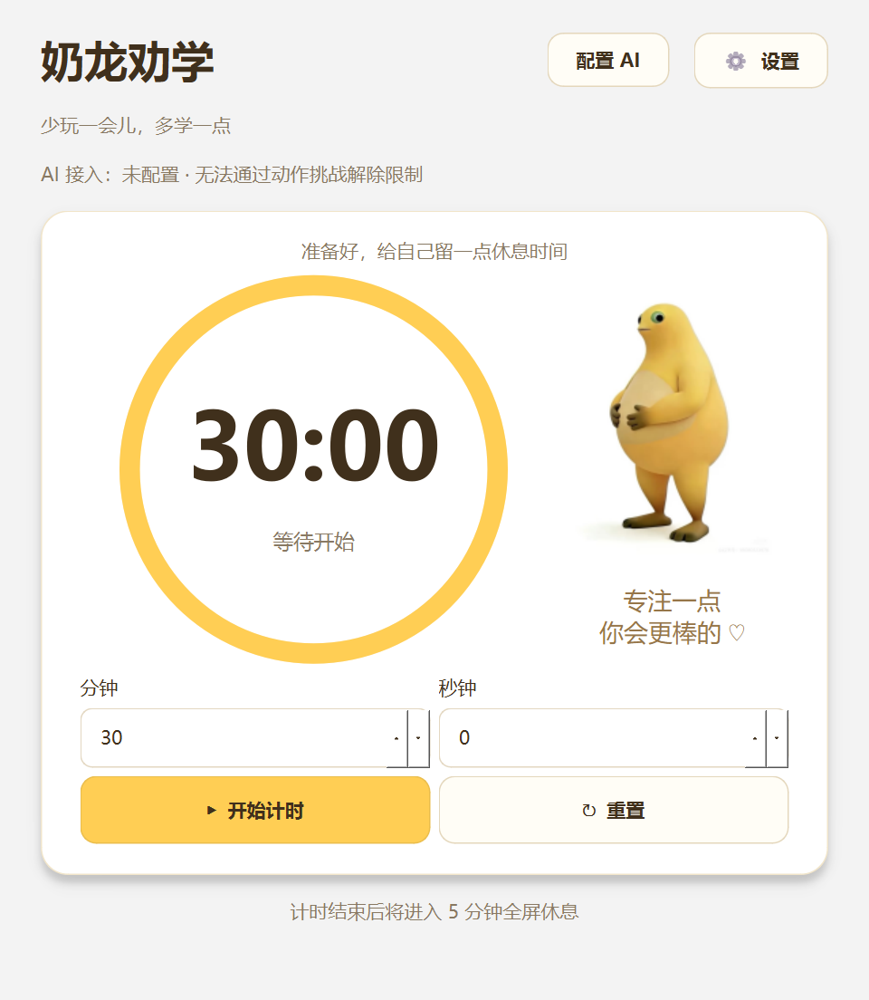
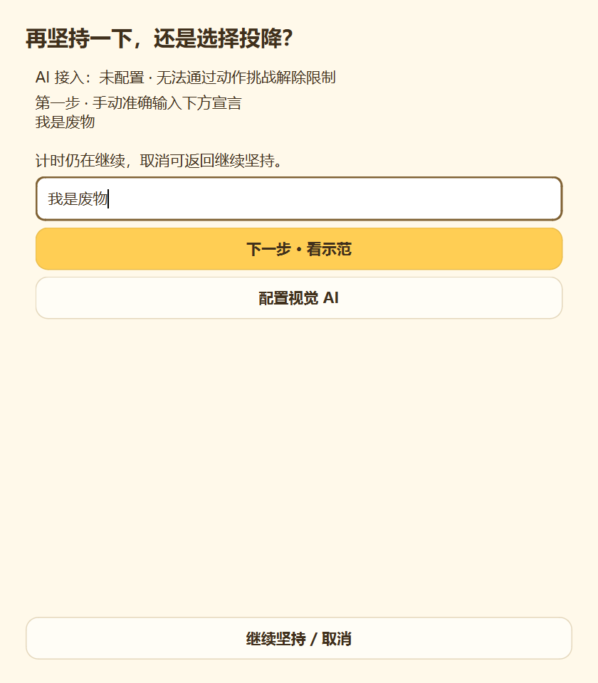
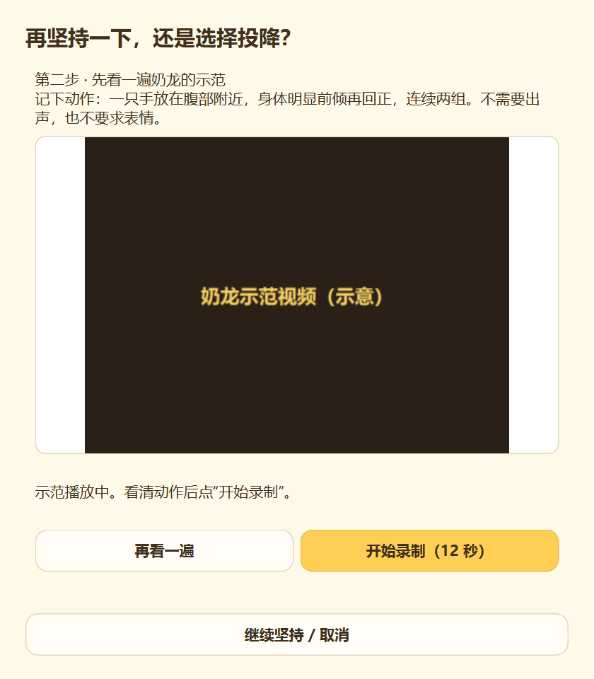
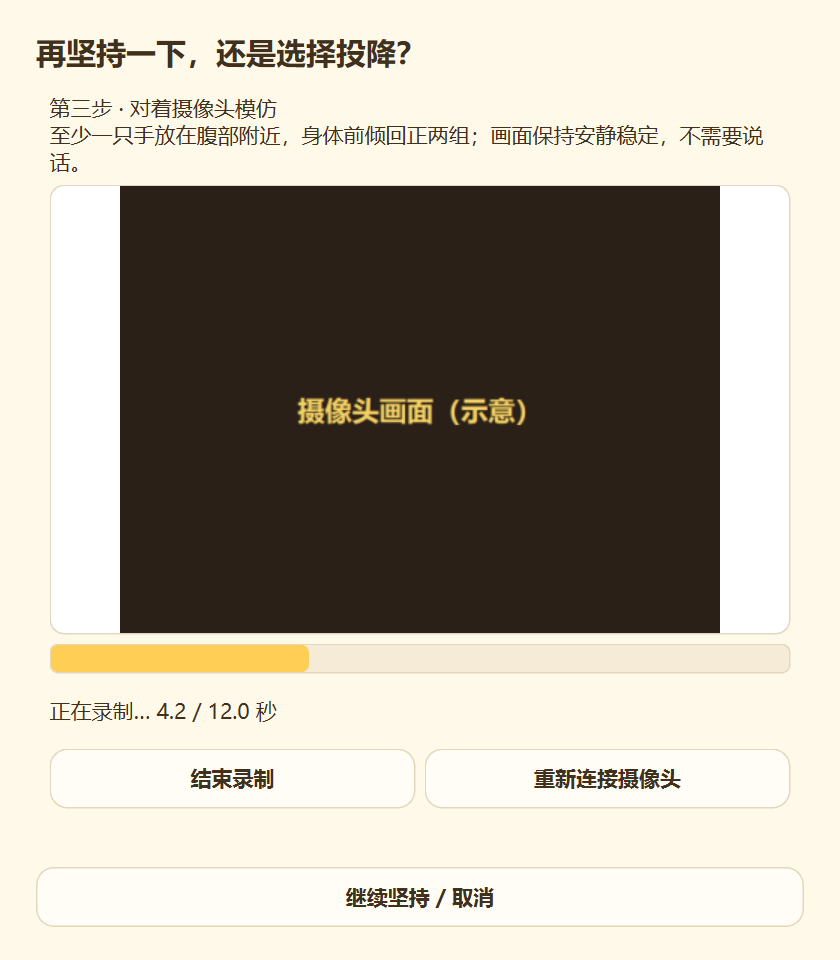
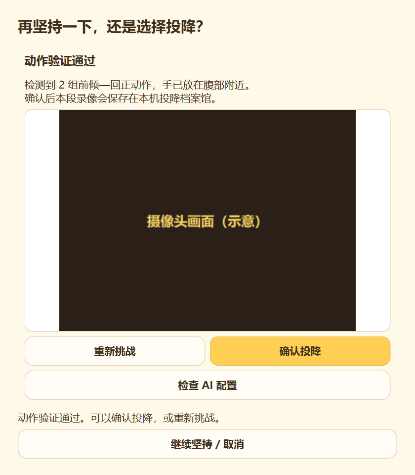
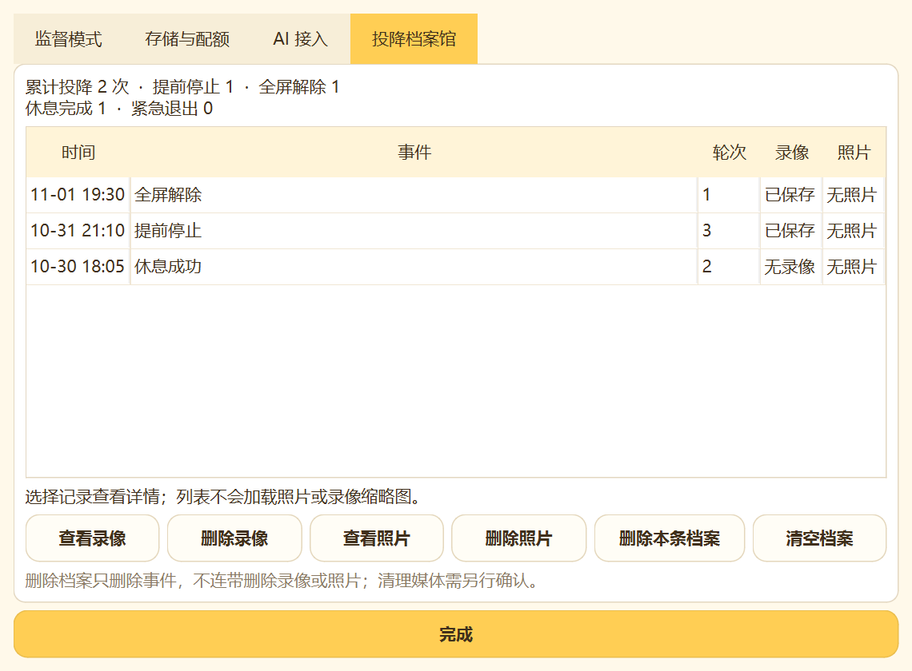

<div align="center">

# 奶龙劝学

### 还敢玩？再玩奶龙给你槽翻。

**你可以继续玩，但时间到了，奶龙真的会来！**

适用平台： <strong>Windows 10 / 11（64 位）</strong>　·　当前版本： <strong>v2.0.1</strong>　·　本地运行，无需注册

</div>

「奶龙劝学」是一款有点可爱、又有点严格甚至有点恐怖的 Windows 桌面自律工具。你负责设定电脑使用时间，奶龙负责提醒你按时休息。如果想提前结束监督，得先照着奶龙的样子做一遍动作，让摄像头和视觉模型一起确认——做不像，就继续待着。

> V2.0 把 V1.1 的「拍照投降」换成了「奶龙大笑动作模仿挑战」：看一遍奶龙示范，录一段 12 秒的动作，由你自己配置的视觉模型判断你做没做到。

---

## 下载 Windows 版

### [⬇ 下载奶龙劝学 v2.0.1（Windows x64 免安装包）](https://github.com/goodluck55k/NailongQuanxue/releases/tag/v2.0.1)

- 下载完整的 `NailongQuanxue-v2.0.1-Windows-x64.zip`（约 48 MB）。**不要单独下载 EXE**：程序依赖同一压缩包里的 `_internal`（资源位于 `_internal/assets/`），只拿一个 EXE 打不开。
- 同一 Release 页面还提供 `NailongQuanxue-v2.0.1-Windows-x64.zip.sha256`，可以用 `certutil -hashfile .\NailongQuanxue-v2.0.1-Windows-x64.zip SHA256` 核对下载是否完整。
- 解压到任意普通文件夹，双击 `NailongQuanxue\NailongQuanxue.exe` 即可运行。不需要安装 Python，也不需要管理员权限。
- **首次启动**：未配置视觉 AI 时会弹出配置窗口，可以先点「稍后配置」——计时、五分钟休息、托盘和紧急退出都能立即使用，只有「提前投降」的动作核验需要 AI。
- **第一次录制**：可能需要手动在 Windows 设置 → 隐私和安全性 → 摄像头 中开启桌面应用摄像头访问权限（见 [Windows 使用说明](README-Windows.md)）。
- **关于签名**：压缩包里的 EXE **没有数字签名**，也不是安装程序。Windows SmartScreen 可能提示"未知发布者"，点击「更多信息 → 仍要运行」即可。本项目不提供已签名安装包，请不要把本程序当作经过签名的软件分发。

---

## 认识你的桌面监督员

打开奶龙劝学，设置分钟和秒钟，点击「开始计时」，就可以继续使用电脑。倒计时结束后，奶龙会登场，陪你完成 5 分钟的全屏休息。

主界面采用奶油黄配色：简洁的计时圆环、直观的操作按钮，底部一行随时告诉你当前的 AI 接入状态。

<p align="center">
  
</p>

## 奶龙有什么本事？

- **使用时间倒计时：** 自由设置分钟和秒钟；最后五分钟逐分钟提醒，最后十秒还有连续倒数。

- **奶龙强制休息：** 时间一到，主显示器静音循环播放奶龙视频，休息满五分钟后自动解除遮挡。

- **手动 / 自动监督：** 可以每轮手动启动，也可以开启自动循环，让监督与休息接力进行。

- **动作模仿挑战：** 想提前停止计时或解除休息画面？先写下投降宣言「我是废物」，看完奶龙示范，再用摄像头录下自己模仿的动作。

- **视觉模型核验：** 由你自己配置的视觉 API 判断动作是否达标：至少一只手放在腹部附近、身体有明显前倾与回正、至少两组完整动作。不判断声音、音色、音高，也不判断表情。

- **投降档案馆：** 每次投降都留下录像与档案，保存在本地，可以查看、播放与清理。

<table width="100%">
  <tr>
    <td width="50%" align="center" valign="top">
      <p><strong>奶龙强制休息</strong></p>
      
    </td>
    <td width="50%" align="center" valign="top">
      <p><strong>投降书与动作挑战</strong></p>
      
    </td>
  </tr>
  <tr>
    <td width="50%" align="center" valign="top">
      <p><strong>奶龙示范</strong></p>
      
    </td>
    <td width="50%" align="center" valign="top">
      <p><strong>录制并核验</strong></p>
      
    </td>
  </tr>
  <tr>
    <td width="50%" align="center" valign="top">
      <p><strong>判定结果</strong></p>
      
    </td>
    <td width="50%" align="center" valign="top">
      <p><strong>投降档案馆</strong></p>
      
    </td>
  </tr>
</table>

## 想投降？先过奶龙这一关

正常监督期间，点击「停止计时」或休息画面中的「解除限制」，会开启三步式投降流程：

1. **写投降书。** 准确输入指定宣言「我是废物」。

2. **看奶龙示范。** 静音循环播放一遍内置的奶龙视频；看完才能进入录制。

3. **模仿并核验。** 摄像头录制约 12 秒，从录像里均匀取 10 帧交给视觉模型。判定通过后，「确认投降」才会亮起；不通过就重录，次数不限。

动作标准（任何一条不满足都不算通过）：

- 至少一只手放在腹部附近；
- 身体完成明显的前倾及回正；
- 至少完成两组完整动作。

核验失败的原因会直接显示在对话框里：没做到、画面里看不到完整动作、模型不可用、网络异常——**只有明确判定通过才会放行**，其余情况一律按未通过处理，可以立刻重试。

中途可以取消投降、继续坚持。投降过程不会暂停原有倒计时；如果时间自然结束，未完成的投降就会失效。

> 每一次想提前跑路，奶龙都会记上一笔，真想让奶龙给你们这群废物槽翻。

## 先配置视觉 AI

V2.0 不再内置任何模型，动作核验需要你自己接一个**支持图像输入**的接口，同时电脑上要有可用的摄像头：

- **接口协议：** OpenAI 兼容（`/chat/completions`）、Anthropic Messages（`/v1/messages`）、Google Gemini（`generateContent`）。
- **Base URL / API Key / 模型 ID：** 全部由你填写，只保存在本机 `settings.json`。
- **进入主界面就会提醒：** 未配置时会弹出配置窗口，可以点「稍后配置」；之后随时可以从主界面或投降对话框重新打开。
- **未配置的后果：** 计时与五分钟休息照常工作，但**动作挑战无法通过**，不会出现"什么都还没接就放行"的情况。
- **不受影响的功能：** 五分钟休息自动结束、托盘「紧急退出」，都不依赖 AI 状态。

> 模型必须真的能看图。只返回文字、不接受图像输入的接口，会在核验时被判为配置错误，不会被当成通过。

## 四步开始使用

1. **获取程序：** 到 [Releases 的 v2.0.1 页面](https://github.com/goodluck55k/NailongQuanxue/releases/tag/v2.0.1) 下载 `NailongQuanxue-v2.0.1-Windows-x64.zip`，解压整个文件夹。也可以克隆源码后按 [Windows 使用说明](README-Windows.md) 在本地运行 `build.ps1` 自行打包。

2. **解压：** 解压整个文件夹，双击 `NailongQuanxue.exe`。不需要安装 Python，也不需要管理员权限。

3. **计时：** 设置使用时长，点击「开始计时」。软件最小化后仍可继续监督。

4. **休息：** 时间一到，和奶龙一起休息五分钟。休息结束后自动返回桌面；自动循环模式下会继续下一轮。
   关闭窗口会缩到系统托盘，托盘菜单里也能开始计时、停止计时或紧急退出；历史投降记录在「设置 → 投降档案馆」里查看。

更详细的安装步骤参见 [Windows 使用说明](README-Windows.md)。

## 隐私与安全

- **数据留在本地。** 不需要账号，不连接自家服务器；档案、录像、配置都在 `%LOCALAPPDATA%\NailongQuanxue`。

- **只有你配置的 AI 会收到画面。** 动作核验时，从录像里取的 10 张静止画面会发送到你填写的 Base URL。除此之外没有任何上传；不发送音频，也不录麦克风。

- **摄像头由你主动开启。** 只有进入「录制」那一步才会启动相机；录像结束即关闭，不录麦克风、不提取音频。示范视频本身静音播放。
- **Windows 摄像头权限。** 部分电脑（含本项目的开发机）会按"程序路径"单独授权摄像头。如果提示没有可用摄像头，去 设置 → 隐私和安全性 → 摄像头 里允许本程序访问即可；源码开发者可以在源码目录运行 `tools\camera_check.ps1` 查看授权状态并做自检；Windows 发行包不包含该脚本。

- **文件可管理。** 投降录像有 512 MiB 的应用管理额度，照片有 100 MiB；两者都可以在设置里查看、删除，目录也可以更换。

- **保留紧急出口。** 可通过 Windows 系统托盘选择「紧急退出」，确认后立即停止监督并返回待机，不需要投降书、录像或 AI。

- **不会主动断网。** 软件不修改 Wi-Fi 或以太网连接，也不拦截 Windows 安全操作。它是自律辅助工具，而不是无法绕过的系统锁屏。

详见 [隐私说明](PRIVACY.md)。

## 技术与开发

**技术栈：** Python 3.11 · PySide6 · SQLite · PyInstaller（视觉接口用标准库 `urllib` 直连，不引入新依赖）

奶龙劝学在 Windows 本地运行，没有自家后端；唯一的外部请求来自你配置的视觉接口。

**本地运行与构建：**

```powershell
python -m venv .venv
.\.venv\Scripts\python.exe -m pip install -r requirements.txt -r requirements-dev.txt
.\.venv\Scripts\python.exe -m pytest -q     # 自动化测试
.\build.ps1                                    # 本地包：dist\v2.0.1-local（含审计、校验和）
.\build.ps1 -Release                           # 发行包：NailongQuanxue-v2.0.1-Windows-x64.zip
```

运行源码：`.\.venv\Scripts\python.exe main.py`；打包产物：`dist\v2.0.1-local\NailongQuanxue\NailongQuanxue.exe`。
`-Release` 会去掉本地专用提示文件、强制检查包内不含任何用户数据，并生成与 Release 附件同名的 ZIP 和 `.sha256`；推送 `v*` 标签时 `.github/workflows/release.yml` 会在 Windows Runner 上重复同一套测试、打包、审计与校验，然后自动创建 Release。
遇到配置存不下来时，`NailongQuanxue.exe --save-probe` 会分阶段报告是哪一步被拒绝，见
[配置保存失败诊断](docs/配置保存失败诊断.md)。

开发者可查看以下文档：

- [Windows 使用说明](README-Windows.md)
- [摄像头与录像验证报告](docs/P1-摄像头与录像验证报告.md)（本机实测 7/7 通过）
- [人工验收清单](docs/人工验收清单.md)（按操作顺序逐条勾选）
- [版本迁移记录](MIGRATION_V1_1.md)
- [测试报告](TEST_REPORT.md)
- [手动验收清单](MANUAL_TESTS.md)
- [版本更新说明](RELEASE_NOTES.md)

## 许可证与素材说明

本项目原创代码采用 [MIT License](LICENSE)，Copyright © 2026 goodluck55k。

MIT 许可证仅适用于原创代码；仓库内使用的奶龙视频、角色图片及设计参考素材不因此自动获得 MIT 授权。相关素材信息参见 [素材清单](assets/ASSET_MANIFEST.md)，第三方依赖许可参见 [THIRD_PARTY_NOTICES.md](THIRD_PARTY_NOTICES.md)。

---

<p align="center">
  <strong>少玩一会儿，不然奶龙给你槽翻。 让奶龙陪你，认真休息五分钟。🐉</strong>
</p>
