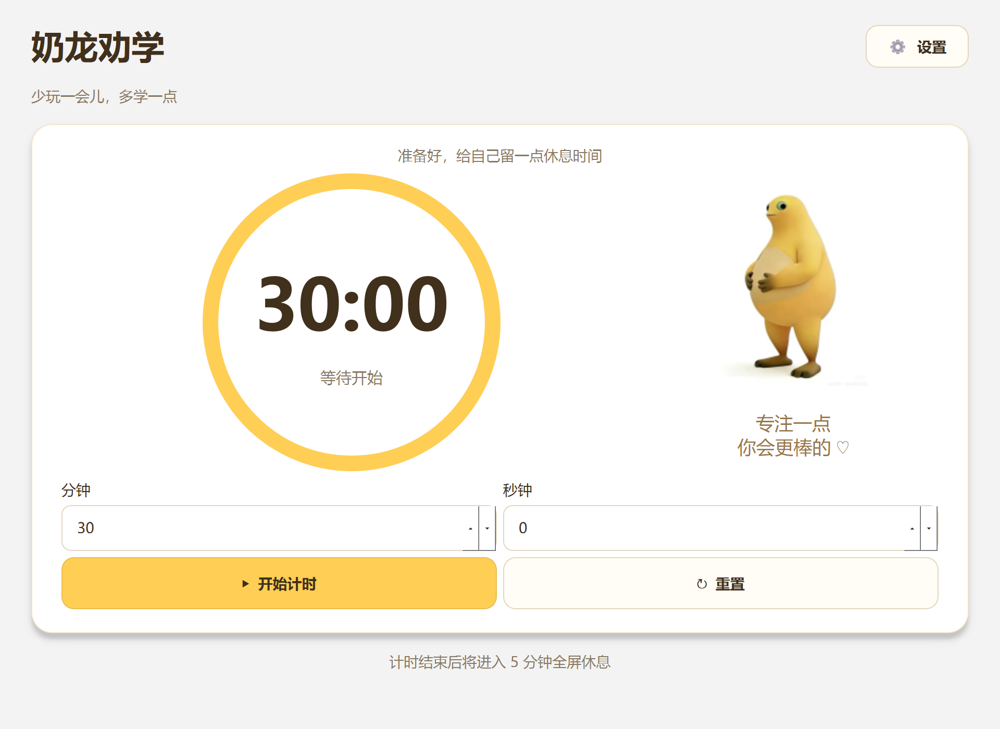
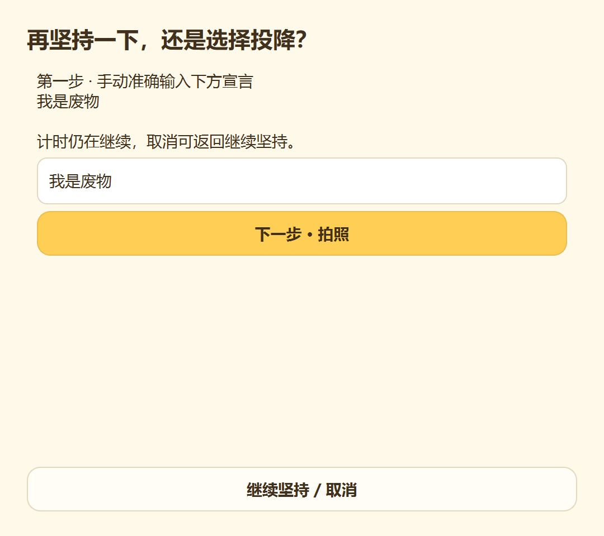
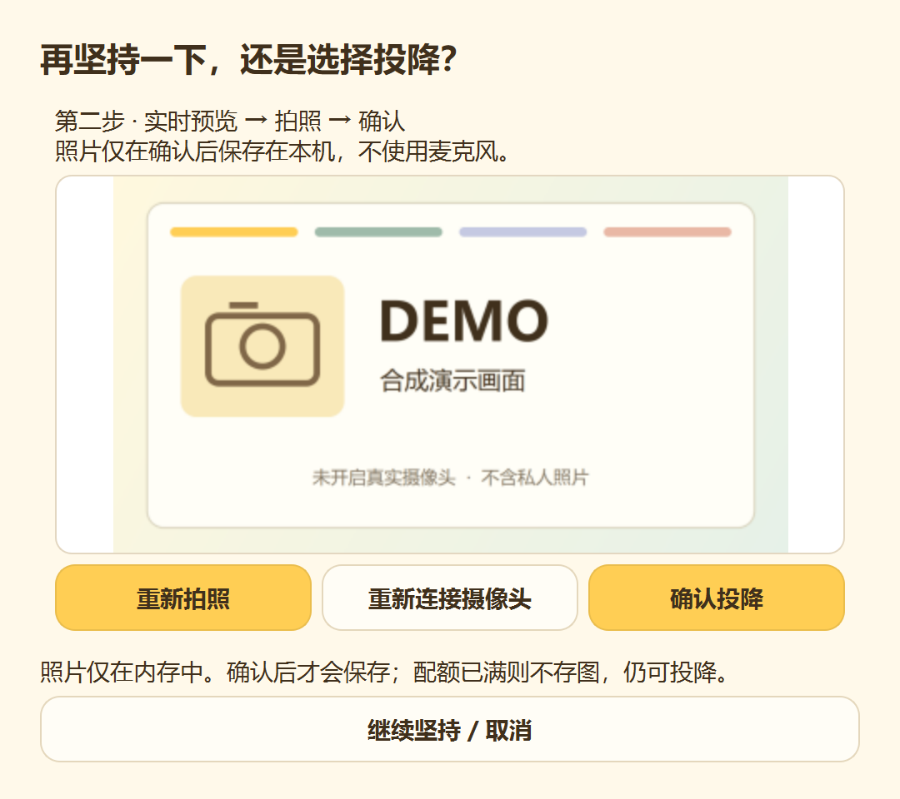
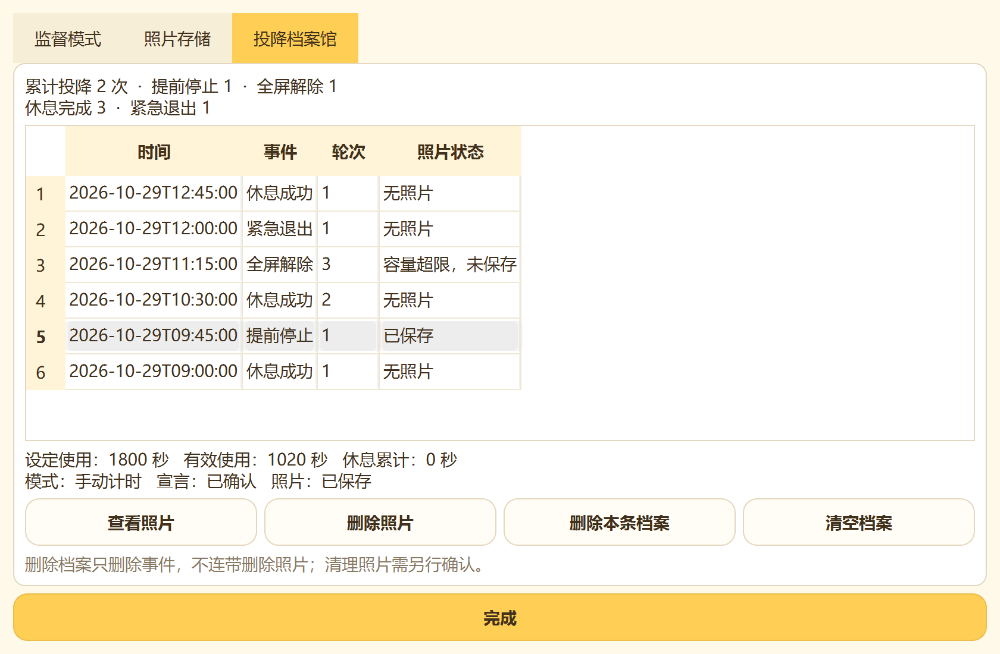

# 奶龙劝学

### 还敢玩？再玩奶龙给你槽翻。

**你可以继续玩，但时间到了，奶龙真的会来！**

适用平台： <strong>Windows 10 / 11（64 位）</strong>　·　当前版本： <a href="https://github.com/goodluck55k/NailongQuanxue/releases/tag/v1.1.0"><strong>v1.1.0</strong></a>　·　本地运行，无需注册

「奶龙劝学」是一款有点可爱、又有点严格甚至有点恐怖的 Windows 桌面自律工具。你负责设定电脑使用时间，奶龙负责提醒你按时休息。如果想提前结束监督，还要认真完成一场“投降仪式”（没错你个废物，连这个都做不到，活该颓废下去）。

**[⬇️ 下载 Windows 完整版](https://github.com/goodluck55k/NailongQuanxue/releases/download/v1.1.0/NailongQuanxue-v1.1.0-Windows-x64.zip)　·　[查看所有发布版本](https://github.com/goodluck55k/NailongQuanxue/releases)**

> 请下载并完整解压 ZIP，保留 `_internal` 等文件，再运行 `NailongQuanxue.exe`。单独下载 EXE 无法代替完整运行包。

---

## 认识你的桌面监督员

打开奶龙劝学，设置分钟和秒钟，点击「开始计时」，就可以继续使用电脑。倒计时结束后，奶龙会登场，陪你完成 5 分钟的全屏休息（其实是你们这群没有自制力的dog son需要奶龙来监督）。

主界面采用奶油黄配色：简洁的计时圆环、直观的操作按钮，还有随时待命的奶龙（还有一个乐不思蜀的你）。

  

## 奶龙有什么本事？

- **使用时间倒计时：** 自由设置分钟和秒钟；最后五分钟逐分钟提醒，最后十秒还有连续倒数。

- **奶龙强制休息：** 时间一到，主显示器静音循环播放奶龙视频（本来想加入声音的，但是怕你们在公共场合外放，比如图书馆），休息满五分钟后自动解除遮挡。

- **手动 / 自动监督：** 可以每轮手动启动，也可以开启自动循环，让监督与休息接力进行。

- **投降书挑战：** 想提前停止计时或解除休息画面？先完成指定的投降宣言（“我是废物”）。

- **拍照确认：** 投降还需要主动拍照并确认；可以预览和重拍，不进行人脸识别（后续版本可能会加入人脸检测）。

- **投降档案馆：** 每次投降都有记录；历史照片和档案保存在本地，可以自行查看与清理。

<table width="100%">
  <tr>
    <td width="50%" align="center" valign="top">
      
<strong>奶龙强制休息</strong>

      
    </td>
    <td width="50%" align="center" valign="top">
      
<strong>投降书挑战</strong>

      
    </td>
  </tr>
  <tr>
    <td width="50%" align="center" valign="top">
      
<strong>拍照确认</strong>

      
    </td>
    <td width="50%" align="center" valign="top">
      
<strong>投降档案馆</strong>

      
    </td>
  </tr>
</table>

## 想投降？先过奶龙这一关

正常监督期间，点击「停止计时」或休息画面中的「解除限制」，会开启两步式投降流程：

1. **写投降书。** 准确输入指定宣言「我是废物」。

2. **拍照留念。** 打开摄像头、拍照预览，最后点击「确认投降」。

中途可以取消投降、继续坚持。投降过程不会暂停原有倒计时；如果时间自然结束，未完成的投降就会失效。

> 每一次想提前跑路，奶龙都会记上一笔，真想让奶龙给你们这群废物槽翻。

## 四步开始使用

1. **下载：** 从 Releases 获取 Windows 完整 ZIP 包。

2. **解压：** 解压整个文件夹，双击 `NailongQuanxue.exe`。不需要安装 Python，也不需要管理员权限。

3. **计时：** 设置使用时长，点击「开始计时」。软件最小化后仍可继续监督。

4. **休息：** 时间一到，和奶龙一起休息五分钟。休息结束后自动返回桌面；自动循环模式下会继续下一轮。

更详细的安装步骤参见 [Windows 使用说明](README-Windows.md)。

## 隐私与安全

- **数据留在本地。** 软件不需要账号或云端服务，不会上传投降照片和档案。

- **摄像头由你主动开启。** 只有进入投降拍照步骤时才会启动相机；不录制视频，也不使用麦克风。

- **照片可管理。** 投降照片有 100 MiB 的应用管理额度；照片与档案可以查看、删除。

- **保留紧急出口。** 可通过 Windows 系统托盘选择「紧急退出」，确认后立即停止监督并返回待机，不需要投降书或拍照。

- **不会主动断网。** 软件不修改 Wi-Fi 或以太网连接，也不拦截 Windows 安全操作。它是自律辅助工具，而不是无法绕过的系统锁屏。

详见 [隐私说明](PRIVACY.md)。

## 技术与开发

**技术栈：** Python 3.11 · PySide6 · SQLite · PyInstaller

奶龙劝学在 Windows 本地运行，无需后端或 AI 服务。开发者可查看以下文档：

- [Windows 使用说明](README-Windows.md)
- [版本迁移记录](MIGRATION_V1_1.md)
- [测试报告](TEST_REPORT.md)
- [手动验收清单](MANUAL_TESTS.md)
- [版本更新说明](RELEASE_NOTES.md)

## 许可证与素材说明

本项目原创代码采用 [MIT License](LICENSE)，Copyright © 2026 goodluck55k。

MIT 许可证仅适用于原创代码；仓库内使用的奶龙视频、角色图片及设计参考素材不因此自动获得 MIT 授权。相关素材信息参见 [素材清单](assets/ASSET_MANIFEST.md)，第三方依赖许可参见 [THIRD_PARTY_NOTICES.md](THIRD_PARTY_NOTICES.md)。

---

  <strong>少玩一会儿，不然奶龙给你槽翻。 让奶龙陪你，认真休息五分钟。🐉</strong>

